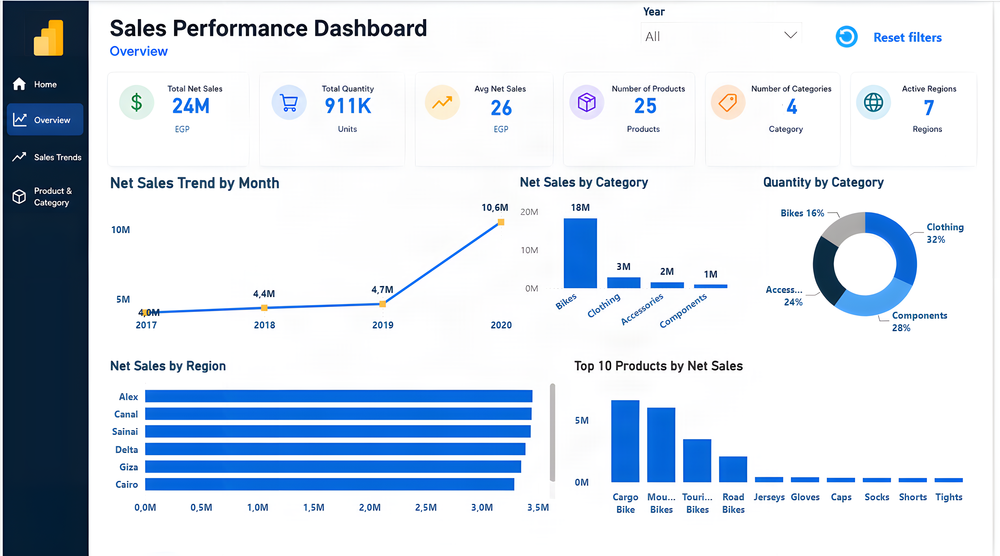
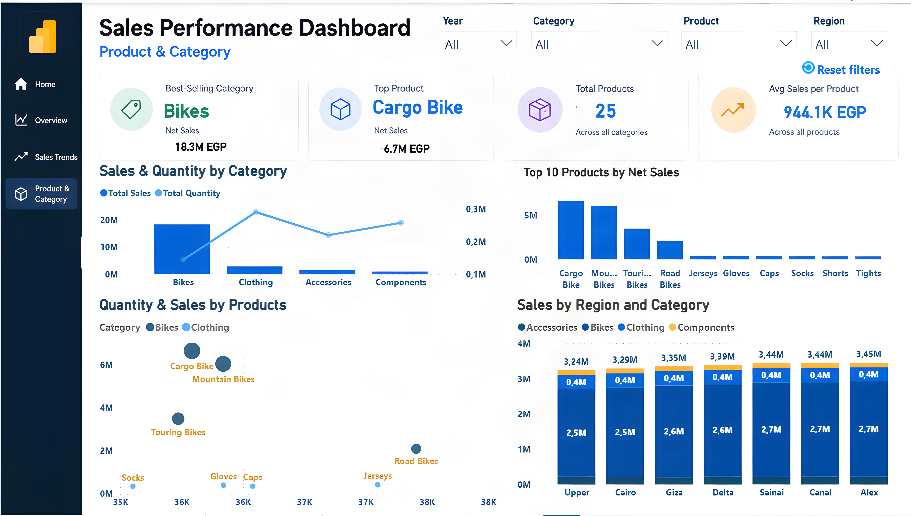

# Sales Performance Dashboard | Power BI

**Power BI · DAX · Power Query · Folder Connector · Business Analytics**

## Project Overview

This project presents an interactive Power BI dashboard designed to monitor sales performance across products, categories, regions, and years.

The dashboard analyzes **23.6M EGP in net sales** from 2017 to 2020, providing insights into revenue growth, product performance, and regional sales distribution.

## Business Objectives

- Track sales performance and identify growth trends.
- Compare sales across products, categories, and regions.
- Identify top-performing products and categories.
- Monitor year-over-year growth and moving averages.
- Streamline recurring data preparation using Power Query.

## Key Performance Indicators

| KPI | Value |
|---|---|
| Total Net Sales | 23,601,279.25 EGP |
| Total Quantity | 911K units |
| Number of Products | 25 |
| Product Categories | 4 |
| Active Regions | 7 |
| 2020 YoY Sales Growth | 126.88% |

## Key Business Insights

### 1. Sales Growth

Net sales increased from 4.65M EGP in 2019 to 10.55M EGP in 2020, representing **126.88% year-over-year growth**.

### 2. Product Performance

Bikes generated **18.3M EGP**, making them the leading sales category.

Cargo Bike was the top-selling product, generating **6.7M EGP** in net sales.

### 3. Regional Performance

Sales were distributed across seven regions, with Alex recording the highest displayed regional sales at **3.45M EGP**.

## Data Preparation & Technical Approach

### Power Query Folder Connector

Used Power Query Folder Connector to combine recurring sales files into a consolidated dataset.

Created reusable transformation steps to standardize and prepare the data.

New files following the same structure can be incorporated during dataset refresh.

### DAX Measures

Developed measures for:

- Total Net Sales
- Previous-Year Sales
- Year-over-Year Growth
- Year-to-Date Sales
- Three-Month Moving Average

### Interactive Reporting

Designed three analytical pages with interactive filters for year, category, product, and region.

## Dashboard Pages

### Sales Overview

### Sales Trends

### Product & Category Analysis

## Business Recommendations

- Monitor sales growth by year and product category.
- Investigate the concentration of revenue in the Bikes category.
- Compare regional product mixes to identify expansion opportunities.
- Use monthly trends and moving averages to support sales planning.

## Tools & Technologies

- Power BI
- Power Query
- Power Query Folder Connector
- DAX
- Data Modeling
- Business Analytics

## Project Scope

This project demonstrates sales reporting, trend analysis, and reusable data preparation workflows using Power BI. Findings are based on the project dataset and are not presented as realized business improvements.
